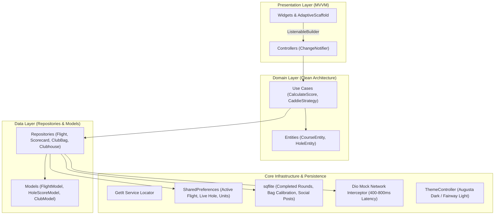
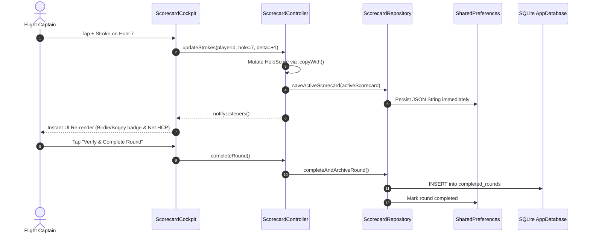

# Golfer

[](https://github.com/Safeer-Hussain/golfer/actions/workflows/ci.yml)
[](https://flutter.dev)
[](https://dart.dev)
[](https://opensource.org/licenses/MIT)

Interactive Multi-Player Golf Flight Manager, Automated Digital Scorecard, GPS Course Rangefinder, and On-Device AI Caddie Ecosystem built in Flutter with strict Feature-First Clean Architecture and MVVM state management.

---

## Architecture Overview



### Reactive State Flow



---

## Feature Matrix

| Module | Core Capability | Offline Engine | Architecture Highlight |
|---|---|---|---|
| **Module 1: Flight Lobby** | 1 to 4 multi-player flight setup, custom players, tees | `SharedPreferences` | WHS Slope & Course Handicap auto-calc |
| **Module 2: Scorecard** | Hole 1-18 Cockpit, Gross/Net, Stableford, OUT/IN/TOTAL | `sqflite` + `SharedPreferences` | ASCII Scorecard Export, Leadboard Drawer |
| **Module 3: Rangefinder** | OpenStreetMap canvas, target crosshair, pin distances | `latlong2` Local Geodesics | Live Shot Carry GPS tracker into club bag |
| **Module 4: AI Caddie** | Atmospheric wind vector & elevation playing-distance | On-device strategy engine | Token-by-token streaming with `try-finally` |
| **Module 5: Clubhouse** | Handicap & Scoring charts (`fl_chart`), 14-club bag | `sqflite` | Reactive likes, comment threads, post modal |

---

## Pre-emptive Safety & Architecture Compliance

1. **Android SDK 36 Compatibility**: `compileSdk = 36`, `targetSdk = 36`, and `minSdk = 21` configured in `android/app/build.gradle.kts`.
2. **Impeller Protection**: Vulkan crash protection meta-data enabled in `AndroidManifest.xml` for MediaTek and Mali GPUs.
3. **Zero Hardcoded Colors**: Augusta Emerald Dark and Crisp Fairway Light modes resolved through `Theme.of(context).colorScheme`.
4. **Unique Hero Tags**: Explicit hero tags configured across every FloatingActionButton (`fab_flight_start`, `fab_scorecard_quick_log`, `fab_gps_shot_track`, `fab_clubhouse_post`).
5. **Landscape Viewport Safe**: Master-detail two-pane layout with independent scroll views and compact `NavigationRail` verified on 800x360dp screens.
6. **Zero External Paid APIs**: Fully autonomous local persistence and simulated network telemetry.

---

## Getting Started

### Prerequisites
- Flutter SDK 3.47.8 or higher
- Dart SDK 3.13.7 or higher

### Installation & Run
```bash
# Clone the repository
git clone https://github.com/Safeer-Hussain/golfer.git
cd golfer

# Install dependencies
flutter pub get

# Verify static analysis (0 warnings, 0 errors)
flutter analyze

# Run automated unit and widget test suite
flutter test

# Run application on emulator or connected device
flutter run
```

---

## Clean-Room NDA Disclaimer

This software was developed clean-room from public specifications, USGA/WHS handicap formulas, and OpenStreetMap open-access tiles. No proprietary code, confidential assets, or commercial golf APIs were utilized during development.
